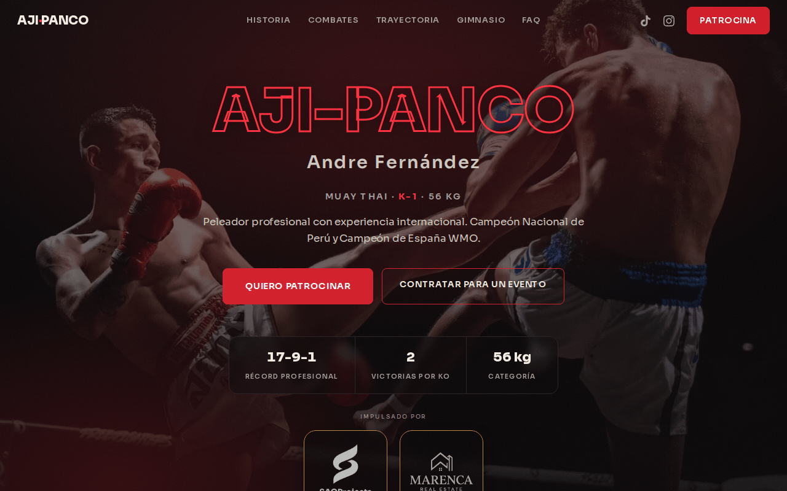
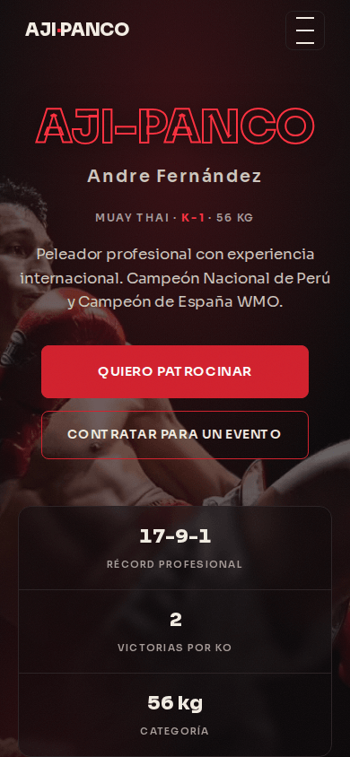
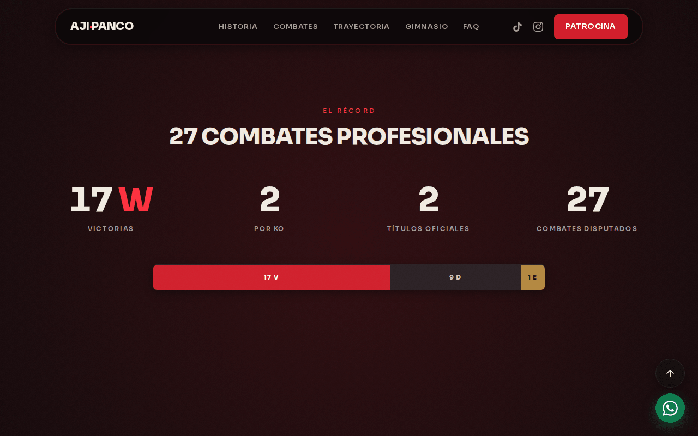
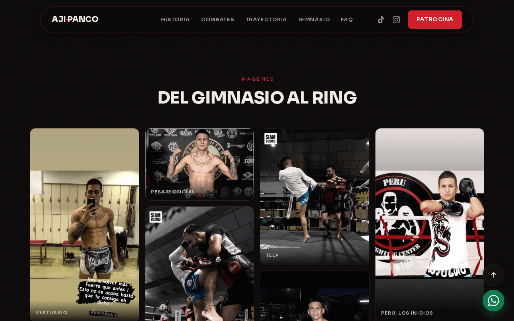

# Andre Fernández «Aji-Panco» — Web oficial

> **Proyecto para cliente** de [SAOProjects Studio](https://saoprojects.es): diseño y
> desarrollo de la web oficial de un peleador profesional, en producción.


Landing de un peleador profesional de Muay Thai y K-1. Sitio estático de una sola página:
HTML + Gulp + SCSS + JS vanilla, sin frameworks. Misma arquitectura que la web de
SAOProjects.

**Producción:** https://andrefernandez.es

> 📄 **La documentación completa está en [DOCUMENTACION.md](DOCUMENTACION.md)**: sistema de
> diseño, tokens y contrastes, paletas alternativas, cómo funcionan el acordeón y la galería,
> mapa de fotos, despliegue y lo que queda pendiente. Este README es solo el arranque.

## Qué incluye

- Secciones: momentos (acordeón de fotos), historia, combates, cifras con contadores,
  trayectoria, galería en mosaico, patrocinio, gimnasio, preguntas frecuentes y contacto.
- Tema oscuro con acento carmesí y contrastes WCAG AA revisados token a token.
- Animaciones condicionadas a `prefers-reduced-motion`.
- Imágenes en AVIF y WebP, CSS con hash de contenido para la caché y rutas relativas
  (funciona en la raíz de un dominio o en un subdirectorio).
- SEO técnico: Open Graph, datos estructurados JSON-LD, `sitemap.xml` y `robots.txt`.
- Despliegue en Hostinger (Apache) sin compilar en el servidor: ver
  [docs/DESPLIEGUE.md](docs/DESPLIEGUE.md).

## Capturas

| Escritorio | Móvil |
|---|---|
|  |  |
| **Cifras** | **Galería** |
|  |  |

*Capturas de la web en producción.*

## Arranque

Los HTML se abren directamente o con cualquier servidor estático, sin compilar nada:
`public/build/` está versionado.

```bash
npm install
npm run dev      # compila y vigila cambios (expandido, con sourcemaps)
npm run build    # producción, minificado
```

Servidor local:

```bash
python3 -m http.server 8901
```

**Antes de commitear cambios de `src/`, ejecuta `npm run build`.** El CSS de producción lleva
hash de contenido; `revIndex` reescribe solo el `<link>` de los dos HTML y `limpiaCss` borra
los hashes viejos y la salida de desarrollo. No hay que tocar nada a mano.

## Estructura

```
src/scss/
  app.scss        entrada principal (solo @use)
  paletas.scss    entrada aparte: paletas alternativas de desarrollo
  base/           _variables (tokens), _globales, _tipografia
  ui/             _botones, _cards, _nav, _footer, _animaciones
  paginas/        _home (barril) + una hoja por sección
src/js/
  main.js         nav, menú móvil, reveal, FAQ, contadores
  paletas.js      conmutador de paletas (inerte sin ?paletas en la URL)
src/img/
  fotos/          las 26 fotos que usa la web
  sin-usar/       material que hoy no aparece — NO se compila
public/build/     salida de gulp (versionada)
docs/             plan, despliegue, deuda técnica y capturas
```

## Ver las paletas alternativas

Cinco variantes oscuras sobre la página completa. Añade `?paletas` a la URL:

```
http://localhost:8901/?paletas
```

La hoja solo se descarga con ese parámetro: el visitante nunca la carga y la paleta de
producción sigue siendo la carmesí.

## Antes de tocar nada

- No pongas texto de acento en `--accent`: suspende AA. Para eso está `--accent-text`.
- Si reordenas los paneles de Momentos, revisa los `object-position` por `nth-child`.
- Si añades un logotipo, recórtalo a su caja de contenido o se verá de distinto tamaño.

El detalle de cada una de estas trampas, en [DOCUMENTACION.md](DOCUMENTACION.md).

## Créditos

Diseño y desarrollo: [SAOProjects Studio](https://saoprojects.es). Textos y fotografías
propiedad del cliente.

<details>
<summary><strong>English</strong></summary>

# Andre Fernández "Aji-Panco" — Official website

> **Client project** by [SAOProjects Studio](https://saoprojects.es): design and development
> of the official website of a professional fighter, live in production.

Landing page for a professional Muay Thai and K-1 fighter. A static one-page site: HTML +
Gulp + SCSS + vanilla JS, no frameworks.

**Production:** https://andrefernandez.es

Full documentation (in Spanish) lives in [DOCUMENTACION.md](DOCUMENTACION.md): design
system, tokens and contrast, alternative palettes, how the accordion and the gallery work,
photo map, deployment and pending work.

## What's inside

- Sections: moments (photo accordion), story, fights, animated stats, career, masonry
  gallery, sponsorship, gym, FAQ and contact.
- Dark theme with a crimson accent and WCAG AA contrast checked token by token.
- Animations gated behind `prefers-reduced-motion`.
- AVIF and WebP images, content-hashed CSS for caching and relative paths (works at a
  domain root or in a subdirectory).
- Technical SEO: Open Graph, JSON-LD structured data, `sitemap.xml` and `robots.txt`.
- Deployed to Hostinger (Apache) with no build step on the server: see
  [docs/DESPLIEGUE.md](docs/DESPLIEGUE.md).

## Screenshots

See the table above (taken from the production site).

## Getting started

The HTML files open directly or from any static server, with no build step:
`public/build/` is committed.

```bash
npm install
npm run dev      # build and watch (expanded, with sourcemaps)
npm run build    # production, minified
```

Local server:

```bash
python3 -m http.server 8901
```

**Run `npm run build` before committing changes to `src/`.** Production CSS carries a content
hash; `revIndex` rewrites only the `<link>` in both HTML files and `limpiaCss` removes old
hashes and the development output.

## Structure

See the tree above: `src/scss` (base, ui, per-section pages), `src/js`, `src/img` and the
committed `public/build/` output.

## Alternative palettes

Five dark variants over the full page. Add `?paletas` to the URL
(`http://localhost:8901/?paletas`). The stylesheet only loads with that parameter, so
visitors always get the production crimson palette.

## Before changing anything

- Don't use `--accent` for accent text: it fails AA. Use `--accent-text`.
- If you reorder the Moments panels, review the `object-position` rules per `nth-child`.
- If you add a logo, crop it to its content box or it will render at a different size.

## Credits

Design and development: [SAOProjects Studio](https://saoprojects.es). Copy and photographs
belong to the client.

</details>
